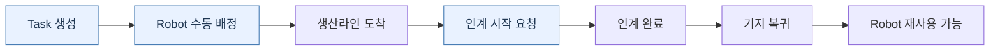
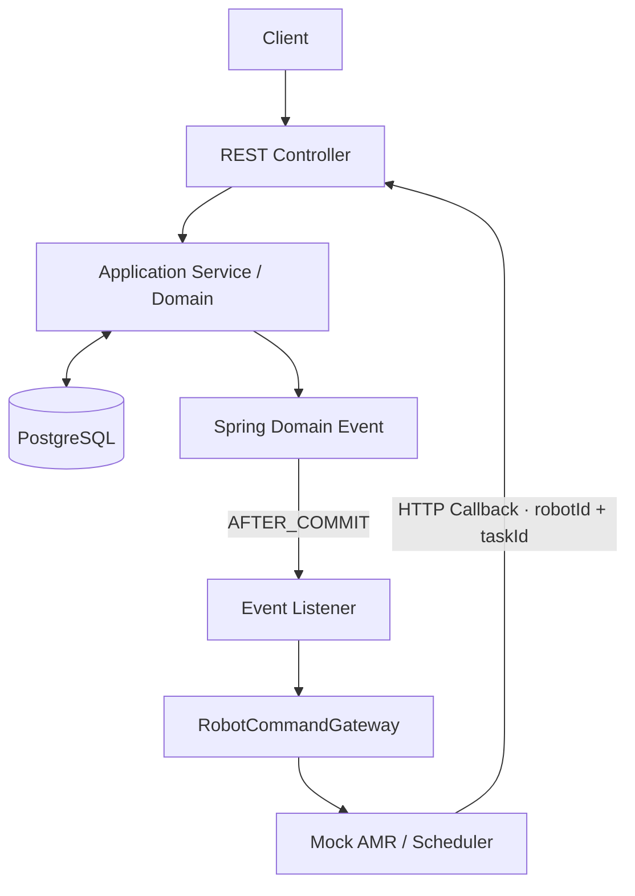

# RobotOps V1

### Fleet Core & State Consistency

**스마트팩토리 자재 보급을 위한 로봇 Fleet 운영 백엔드**

로봇을 *움직이는 것*보다, **작업과 로봇의 상태를 일관되게 관리하는 것**에서 출발했습니다.

  

**개발 기간:** 2026.10 – 2026.11 · **개발 형태:** 개인 프로젝트 · **단계:** V1

---

## 01. Overview

RobotOps는 스마트팩토리에서 여러 로봇의 작업과 운영 상태를 신뢰성 있게 관리하는 플랫폼을 목표로 하는 장기 프로젝트입니다. **V1은 그 출발점**으로, 자동차 부품 생산라인에 자재를 보급하는 **단일 Robot 운반 사이클**을 구현했습니다.

핵심 질문은 세 가지입니다.

- **배정 정합성:** 같은 Robot에 서로 다른 Task가 동시에 배정되지 않는가?
- **상태 정합성:** 운반·인계·복귀 과정의 상태가 실패 후에도 일관적인가?
- **콜백 정합성:** 이전 Task의 늦은 완료 보고가 다음 Task에 영향을 주지 않는가?

실제 주행이나 자동 배차보다 **도메인 상태 전이, 트랜잭션 경계, 이벤트 전달 시점**을 먼저 검증하는 데 집중했습니다.

## 02. Core Scenario

| 구간 | 동작 주체 | 주요 상태 변화 |
|---|---|---|
| 작업 생성·배정 | Client → Platform | `Task: WAITING → ASSIGNED` · `Robot: IDLE → DELIVERING` |
| 생산라인 도착 | Mock AMR → HTTP callback | `Robot: DELIVERING → WAITING_FOR_HANDOVER` |
| 자재 인계 | Client 요청 → Mock AMR callback | `Robot: HANDOVER → RETURNING` · `Task: COMPLETED` |
| 기지 복귀 | Mock AMR → HTTP callback | `Robot: RETURNING → IDLE` · `currentTask = null` |

**배정과 인계 시작은 클라이언트가 명시적으로 요청**합니다. 이동·인계 완료·복귀 보고는 Mock AMR이 지정된 지연 이후 HTTP로 전달합니다. 인계 완료 시 생산라인 점유가 해제되며, 복귀 후에는 `Task.robot` 이력을 남긴 채 Robot을 재사용할 수 있습니다.

## 03. Tech Stack

| 영역 | 기술 |
|---|---|
| Application | Java 21 · Spring Boot 3.5 · Spring MVC |
| Persistence | Spring Data JPA · Hibernate · PostgreSQL 16 |
| Consistency | Spring Transaction · PostgreSQL `PESSIMISTIC_WRITE` |
| Integration | Spring Events · `@TransactionalEventListener(AFTER_COMMIT)` · Java `HttpClient` |
| Simulation | `ScheduledExecutorService` 기반 Mock AMR |
| Verification | JUnit 5 · Mockito · Spring Boot Test · PostgreSQL 통합 테스트 |

## 04. System Architecture

**DB 상태 변경과 외부 명령 전달의 책임을 분리**했습니다. Service가 트랜잭션 안에서 상태를 변경하고 이벤트를 발행하면, 커밋 이후 Listener가 Gateway를 통해 Mock AMR에 명령을 전달합니다. Mock AMR은 같은 프로세스에서 실행되지만 완료 보고는 실제 HTTP 요청으로 돌아옵니다.

> 상세한 엔티티 관계·상태 전이·잠금 순서는 [Architecture](docs/architecture.md)에서 확인할 수 있습니다.

## 05. Key Engineering Decisions

| 해결하려는 문제 | 선택한 설계 | 확보한 성질 |
|---|---|---|
| 여러 엔티티의 부분 변경 | `@Transactional`로 Robot·Task·ProductionLine 변경 관리 | 업무 실패 시 DB 변경 롤백 |
| 동일 Robot에 대한 동시 배정 | Robot 우선 `PESSIMISTIC_WRITE` 잠금과 상태 검증 | 같은 Robot의 중복 배정 차단 |
| 롤백된 작업의 로봇 명령 실행 | `AFTER_COMMIT` Listener + `RobotCommandGateway` | 커밋된 변경 이후에만 명령 전달 시도 |
| 이전 Task의 지연 완료 보고 | `robotId + taskId` 전달 및 `currentTask` 일치 검증 | 오래된 인계·복귀 콜백의 오적용 거부 |

**핵심 불변식:** 하나의 Robot은 동시에 하나의 Task만 수행합니다. 작업 완료와 기지 복귀는 별개의 단계이며, Robot은 **복귀 완료 후에만** 다음 Task를 받을 수 있습니다.

`AFTER_COMMIT`은 **명령의 내구성이나 최종 전달 성공까지 보장하지는 않습니다.** 또한 Task 생성 API에는 요청 ID 기반 중복 생성 방지 정책이 없습니다. 이 차이를 의도적으로 구분해 기록했습니다.

## 06. Verification Highlights

> **기존 V1 검증 기록 (2026-11-17): 70 tests · 0 failures · 0 errors · 0 skipped · BUILD SUCCESSFUL**

| 검증 대상 | 확인한 결과 |
|---|---|
| 전체 운반 사이클 | LINE_A/B/C의 생성·배정·도착·인계·복귀와 Robot 재사용 확인 |
| 실제 DB 동시성 | 두 독립 트랜잭션의 동일 Robot 배정 경합에서 **정확히 하나만 성공** |
| 롤백 및 외부 명령 | 실패 Task는 `WAITING` 상태 유지, 성공 배정의 Gateway 명령만 1회 발생 |
| 지연 콜백 보호 | 이전 Task의 인계·복귀 완료 보고가 다음 Task 상태를 변경하지 못함 |

동시성 테스트는 PostgreSQL의 `pg_stat_activity`, `pg_blocking_pids`로 **실제 행 잠금 대기**까지 확인했습니다. 이는 단일 Robot 배정 정합성에 대한 검증이며, 다중 Robot의 운영 성능이나 장애 복구 성공률을 뜻하지 않습니다.

## 07. Limitations & Future Scope

V1은 **Fleet 운영의 최소 상태·정합성 코어**입니다. 아래 항목들은 현재 구현의 경계이자 이후 버전에서 검토할 기술적 과제입니다.

| 현재 한계 | 의미 및 영향 |
|---|---|
| 단일 Robot 중심 검증 | 여러 Robot 사이의 배차·협업·경로 충돌과 운영 최적화는 아직 검증하지 않음 |
| 수동 배정·인계 시작 | 가용 Robot 자동 탐색, FIFO 배정, 인계 시작 자동화 및 GET 조회 API 없음 |
| 고정 시간 기반 Mock AMR | 실제 위치·경로·센서·배터리·충전 정보를 반영하지 않음 |
| 메모리 기반 예약과 이벤트 | 재시작 시 예약 유실 가능, 커밋 후 명령 전달 실패를 자동 복구하지 못함 |
| 재시도·멱등성의 제한 | DLQ/Retry 없음, 완료 콜백은 반복 성공하는 멱등 API가 아님 |
| HTTP 오류·타임아웃 정책 | Reporter에 명시적 연결/요청 타임아웃이 없고, 일부 업무 예외가 HTTP 500으로 응답 |
| 생성 요청 식별·운영 지표 | Task 생성용 Request ID가 없으며 장기 부하·복구 시간·Fleet KPI는 본격 검증 전 |

### 다음 단계로의 확장

| 버전 | 확정된 발전 방향 |
|---|---|
| **V2 · Multi-Robot Simulation & Planning** | 다중 Robot · 2D Map · A* · 충돌 회피 · Redis · 경량 대시보드 |

## 08. Documentation

| 문서 | 내용 |
|---|---|
| [Architecture](docs/architecture.md) | 구성 요소, API, 상태 전이와 트랜잭션 경계 |
| [ADR-001 · Mock AMR](docs/adr/001-mock-amr.md) | 실제 주행 대신 지연 기반 시뮬레이션 선택 |
| [ADR-002 · Command Gateway](docs/adr/002-mock-amr-integration.md) | 커밋 후 로봇 명령 전달 구조 |
| [ADR-003 · Task-scoped Callbacks](docs/adr/003-task-scoped-callbacks.md) | 작업별 완료 콜백 식별 및 검증 |
| [ADR-004 · Assignment Locking](docs/adr/004-robot-assignment-locking.md) | 동일 Robot 배정 불변식과 DB 잠금 전략 |

---

*V1은 로봇의 이동보다 먼저, 로봇 운영 데이터가 올바르게 변하는지를 검증합니다.*
