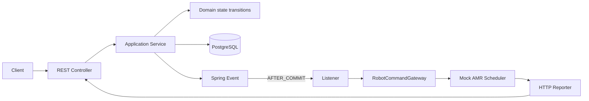
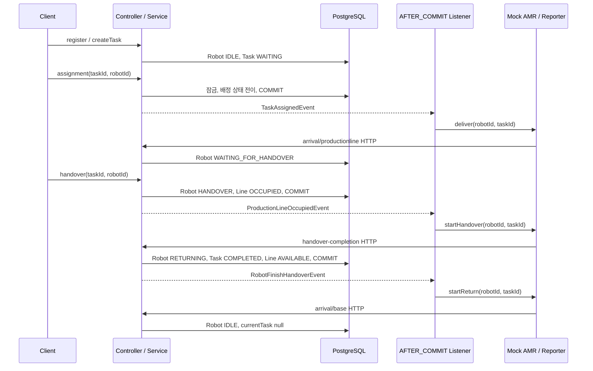

# V1 — Fleet Core & State Consistency

> **Project:** Cloud-native Multi-Robot Autonomy & Operations Platform  
> **Document:** Architecture — Implemented V1 Baseline
> **Updated:** 2026-11-17
> **Status:** V1 구현 구조 및 검증 결과 반영. 본 문서는 V1~V8 로드맵의 순서나 범위를 재정의하지 않는다.

## 1. 프로젝트 개요

자동차 부품 생산라인의 자재 보급을 위한 **단일 Robot 운반 사이클**을 구현한다. 핵심은 실제 주행 알고리즘이 아니라 **Robot·Task·ProductionLine의 상태 전이, 관계 일관성, DB 트랜잭션 정합성**이다.

주요 기술은 Java 21, Spring Boot 3.5.0, Spring MVC, Spring Data JPA, PostgreSQL이다. 운반은 실제 AMR 대신 같은 Spring 애플리케이션 프로세스에서 동작하는 Mock AMR로 모사하며, 도착·인계 완료·기지 복귀 보고는 실제 HTTP 요청으로 전달한다.

**V1 정상 흐름:** Client의 라인 요청(Task 생성) → Client의 명시적 Robot 배정 → Mock AMR의 생산라인 도착 보고 → Client의 명시적 인계 시작 → Mock AMR의 인계 완료 보고 → Mock AMR의 기지 복귀 보고 → Robot IDLE 복귀·재사용.

V1의 운영·검증 기준은 단일 Robot이지만 등록 API 자체가 Robot 개수를 1대로 제한하지는 않는다. 자동 배정/FIFO 소비, Heartbeat, 자동 복구 및 다중 Robot 운영 최적화는 구현하지 않았다.

## 2. 시스템 구성

| 구성 요소 | 책임 / 구현 |
|---|---|
| Client | Robot 등록, Task 생성, 특정 Task·Robot의 배정, 자재 인계 시작 요청 |
| REST Controller | `controller/TaskController.java`, `RobotController.java` — HTTP 요청 바인딩, 서비스 호출 및 201/204 응답 |
| Application Service | `service/TaskService.java`, `RobotService.java`, `ProductionLineService.java` — 트랜잭션, 잠금, 소유관계 검증, 상태 변경, 이벤트 발행 |
| Domain | `domain/Task.java`, `Robot.java`, `ProductionLine.java` — 상태 전이 및 도메인 전제조건 |
| Repository / PostgreSQL | JPA 영속화 및 `PESSIMISTIC_WRITE` 행 잠금 |
| Event / Listener | `command/` — 업무 트랜잭션에서 값 이벤트 발행, 커밋 후 Listener 실행 |
| RobotCommandGateway | `deliver`, `startHandover`, `startReturn` 명령 포트 |
| MockAmrGateway / MockAmr | 동일 프로세스의 Mock 명령 실행; `ScheduledExecutorService`로 지연 보고 예약 |
| HTTP Reporter | 생산라인 도착, 인계 완료, 기지 복귀 콜백을 Platform의 HTTP API로 전송 |
| MockAmrRunner | `mock-demo` 프로필에서 LINE_A 준비·Robot 등록·Task 생성·배정; 인계 시작은 자동 처리하지 않음 |

Mock AMR은 외부 프로세스나 ROS2 노드가 아니다. 다만 지연 콜백은 HTTP 서버에 다시 접속하므로 **별도 HTTP 요청·트랜잭션**에서 처리된다.

### 2.1 REST API

V1의 공개 API는 모두 POST이며 GET 조회 API와 ProductionLine 등록 API는 없다.

| API | 입력 | 성공 응답 | 처리 메서드 |
|---|---|---|---|
| `POST /api/robots` | 본문 없음 | `201 {"robotId":...}` | `RobotService.registerRobot` |
| `POST /api/tasks` | `{"productionLineType":"LINE_A"}` | `201 {"taskId":...}` | `TaskService.createTask` |
| `POST /api/tasks/{taskId}/robots/{robotId}/assignment` | 본문 없음 | 204 | `TaskService.assignTaskToRobot` |
| `POST /api/robots/{robotId}/tasks/{taskId}/arrival/productionline` | 본문 없음 | 204 | `RobotService.reportArrival` |
| `POST /api/robots/{robotId}/tasks/{taskId}/handover` | 본문 없음 | 204 | `ProductionLineService.requestHandover` |
| `POST /api/robots/{robotId}/tasks/{taskId}/handover-completion` | 본문 없음 | 204 | `RobotService.completeHandover` |
| `POST /api/robots/{robotId}/tasks/{taskId}/arrival/base` | 본문 없음 | 204 | `RobotService.completeReturn` |

Task 생성 요청은 `@Valid`와 `@NotNull`을 사용한다. 요청한 `ProductionLine` 레코드가 먼저 존재해야 한다. **동일 라인의 기존 미완료 Task를 조회하여 Task 생성을 차단하는 정책은 없다.** 같은 라인에 여러 WAITING Task를 생성할 수 있으므로, 이를 'Task 생성 중복 방지 구현'으로 표현하지 않는다.

### 2.2 도메인 모델 및 관계

| Entity | 주요 상태·관계 | 일관성 의미 |
|---|---|---|
| Robot | `operationStatus`, `connectionStatus`, `currentTask` (`OneToOne`, nullable) | 현재 진행 중인 작업을 가리키며 기지 복귀 후 null |
| Task | `status`, `robot` (`ManyToOne`, nullable), 필수 `productionLine` (`ManyToOne`) | 완료 이후에도 배정된 Robot 참조는 이력으로 유지 |
| ProductionLine | `ProductionLineType` Enum PK, `status`, `occupyingRobotId` | 점유 Robot을 ID 값으로 저장; Task ID는 보관하지 않음 |

`Robot.currentTask`와 `Task.robot`은 `mappedBy`로 연결된 하나의 양방향 관계가 아니라 **독립적인 두 참조**다. Service가 한 트랜잭션에서 함께 변경·검증한다. 외래키만으로 전체 업무 불변식이 완성되지는 않는다.

`ProductionLineType`의 Mock 지연시간은 LINE_A 운송 5초/인계 3초, LINE_B 10초/5초, LINE_C 15초/7초다. 복귀에도 동일한 운송 시간이 사용된다. 이는 고정 시뮬레이션 지연이며 실제 거리·속도·경로·센서 기반 수치가 아니다.

## 3. 정상 운반 시나리오

1. ProductionLine 초기 데이터를 준비하고 Robot을 등록한다. Robot은 `IDLE/ONLINE/currentTask=null`로 시작한다.
2. Client가 `POST /api/tasks`로 Task를 생성하면 `WAITING`이 된다.
3. Client가 특정 `taskId`와 `robotId`로 배정 요청한다. Robot은 `DELIVERING`, Task는 `ASSIGNED`, Robot.currentTask는 배정 Task를 가리킨다.
4. `TaskAssignedEvent`를 발행하고 DB 커밋 후 Listener가 `gateway.deliver`를 호출한다.
5. Mock AMR이 지연 후 생산라인 도착 HTTP 콜백을 보낸다. Robot만 `WAITING_FOR_HANDOVER`로 변경되며 Task는 `ASSIGNED`, 라인은 `AVAILABLE`이다.
6. **Client가 별도 인계 시작 API**를 호출한다. 소유·상태를 확인한 뒤 ProductionLine을 `OCCUPIED`로 바꾸고 Robot을 `HANDOVER`로 전이한다.
7. `ProductionLineOccupiedEvent(robotId,taskId,handoverSeconds)`가 커밋 후 Mock AMR의 인계 완료 예약을 유발한다.
8. 인계 완료 콜백에서 Robot은 `RETURNING`, Task는 `COMPLETED`, 라인은 `AVAILABLE/occupyingRobotId=null`로 바뀐다. 이 시점에 Robot.currentTask는 유지된다.
9. `RobotFinishHandoverEvent(robotId,taskId,travelSeconds)`가 커밋 후 복귀 보고를 예약한다.
10. 기지 도착 콜백에서 Robot은 `IDLE/currentTask=null`로 복귀해 재사용 가능해진다. Task는 `COMPLETED`이며 Task.robot 이력은 유지된다.

**배정 API의 HTTP 204는 운반 완료가 아니라 배정 트랜잭션 처리를 의미한다.** 각 Mock 보고는 그 이후 별도 요청으로 들어온다. 인계 시작도 자동으로 이어지지 않는다.

### 3.1 경계 및 예외 시나리오

- **가용 Robot 부족:** 자동 큐 소비자나 FIFO 배정이 없으므로 Task는 WAITING으로 남는다. Client가 배정 API를 명시적으로 호출해야 한다.
- **동일 Robot 동시 배정:** Robot 행의 비관적 잠금과 상태 검증으로 경합을 직렬화한다. 후속 요청은 이미 DELIVERING인 Robot에 배정되지 않으며 실패 트랜잭션의 Task 변경은 롤백된다.
- **동일 라인 인계 경합:** 라인 잠금과 `occupy` 검증으로 중복 점유를 거부한다. 자동 대기·재시도는 없다.
- **콜백 역순·중복:** 올바른 단계의 상태 전이만 허용한다. 역순 보고를 저장해 재조립하거나 중복 성공 응답을 주는 멱등 API는 아니다.
- **이전 작업의 지연 콜백:** 인계 완료·기지 복귀 보고에 `taskId`를 포함한다. Robot 잠금 후 `currentTask.id`와 불일치하면 상태를 바꾸기 전에 거부한다. 작업 식별 없는 과거 완료 URL은 지원하지 않는다.
- **통신 장애:** 자동 Heartbeat, timeout 감지, 작업 보류·복구 API는 없다. 지연 HTTP 전송 실패에 대한 내구성 있는 재시도가 없으므로 상태가 남을 수 있다.

## 4. 주요 상태 전이 및 불변식

| 식별자 | 규칙 |
|---|---|
| INV-01 | Robot은 `IDLE`·`ONLINE`·`currentTask=null`일 때만 새 작업을 배정받는다. |
| INV-02 | Task는 `WAITING`·`robot=null`일 때만 배정 가능하다. |
| INV-03 | ProductionLine은 `AVAILABLE`일 때만 점유되고 점유한 동일 Robot ID로만 해제된다. |
| INV-04 | 라인 점유 시점은 생산라인 도착이 아니라 **명시적 인계 시작 요청**이다. |
| INV-05 | 인계 완료는 Robot의 현재 Task ID, Task 소유 Robot, HANDOVER/ASSIGNED 상태, 라인 점유 관계가 모두 맞아야 한다. |
| INV-06 | 복귀 중 Robot 재배정은 금지된다. `RETURNING` 및 완료 Task 확인 후에만 `currentTask`를 해제한다. |
| INV-07 | 도착 콜백은 현재 Task ID 일치·Robot `DELIVERING`·`ONLINE`을 요구한다. |
| INV-08 | 같은 단계의 중복 콜백은 오류로 거부하며 멱등 성공 처리하지 않는다. |
| INV-09 | Task 완료 후에도 `Task.robot` 참조를 이력으로 남긴다. |

### 4.1 상태 전이 요약

| Entity | 전이 | 주요 메서드 |
|---|---|---|
| Task | 생성 → WAITING → ASSIGNED → COMPLETED | 생성자, `assignTo`, `complete` |
| Robot | IDLE → DELIVERING → WAITING_FOR_HANDOVER → HANDOVER → RETURNING → IDLE | `startDelivery`, `arriveAtDestination`, `startHandover`, `finishHandover`, `finishReturn` |
| ProductionLine | AVAILABLE → OCCUPIED → AVAILABLE | `occupy`, `release` |
| Robot 연결 | ONLINE → OFFLINE | `disconnect` (운영 API 및 자동 회복 메커니즘 없음) |

### 4.2 트랜잭션·잠금·명령 경계

서비스 업무 메서드는 `@Transactional`을 사용한다. 상태 변경은 영속성 컨텍스트의 변경 감지로 저장하고, 검증 예외 발생 시 트랜잭션을 롤백한다. 배정은 Robot → Task, 인계 시작·완료는 Robot → Task → ProductionLine, 복귀 완료는 Robot → Task 순으로 잠근다. 도착 보고는 Robot을 잠근다.

Repository는 필요한 엔티티에 `PESSIMISTIC_WRITE`를 사용한다. **동일 Robot 경합은 DB 행 잠금으로 처리하며 Redis 락은 사용하지 않는다.** 동시성 검증의 범위는 현재 단일 PostgreSQL 구성의 핵심 불변식이다.

세 Listener는 `@TransactionalEventListener(phase = AFTER_COMMIT)`로 커밋 후 Gateway를 호출하며 `@Async`는 사용하지 않는다. DB 롤백 시 명령은 전달되지 않는다. 반면 **DB 커밋과 외부 명령 전달은 원자적이지 않다.** 이벤트 저장소/outbox·전달 보장·자동 재시도는 없다.

## 5. 구현 범위와 미구현 사항

**V1에 구현된 기능**

- Robot 등록, Task 생성, 명시적 배정, 도착·인계 시작·인계 완료·복귀 완료 API
- 도메인 상태 전이 및 Robot·Task·ProductionLine 관계 검증
- 트랜잭션과 비관적 잠금을 이용한 동일 Robot 배정 정합성
- 커밋 후 Gateway 명령 전달 및 동일 프로세스 Mock AMR의 지연 HTTP 콜백
- 이전 Task 콜백의 오적용 방지 및 복귀 후 Robot 재사용
- 단일 Robot 정상 사이클·실패·경합 통합 테스트

**V1에 구현하지 않은 기능**

- 자동 FIFO 배정, 작업 조회 API, 인계 시작 자동화
- 동일 생산라인의 Task 생성 요청 ID 기반 중복 판별
- Heartbeat, 통신 장애 감지, 운영자 Recovery, 지속성 있는 Retry/Outbox
- 실제 AMR, 지도·경로·충돌 회피·배터리·충전, ROS2/Gazebo
- Kafka/DLQ, 분산 운영, Kubernetes 및 Prometheus/Grafana/OTel, AI Ops/LLM 기능

위 항목을 V1 구현 기능으로 오인하지 않는다. 후속 로드맵의 버전별 범위는 별도 확정 문서를 따른다.

### 5.1 실행 설정과 Mock 수명

- `src/main/resources/application.properties`: 개발 DB `localhost:5432/fleetops_demo`, 사용자 `fleetops`, 비밀번호 `${DB_PASSWORD}`, `ddl-auto=update`.
- `src/test/resources/application-test.properties`: 테스트 DB `fleetops_test`, `${TEST_DB_PASSWORD}`, `ddl-auto=create-drop`; `cleanup.sql`은 테스트 초기화에 사용된다.
- 일반 `default` 프로필은 ProductionLine 초기 데이터를 자동 생성하지 않는다. `mock-demo` 프로필의 Runner는 LINE_A만 준비한다. LINE_B/C는 별도 데이터 준비가 필요하다.
- `mock-amr.base-url` 기본값은 `http://localhost:${server.port:8080}`이다. 랜덤 포트, context path 또는 프록시 환경에서는 실제 콜백 URL을 지정해야 한다.
- Mock AMR의 지연 작업은 프로세스 메모리에만 존재한다. 종료 시 예약을 취소하며 프로세스 재시작 시 복구하지 않는다.
- Reporter는 동기 HTTP 클라이언트를 사용한다. 명시적 connect/request timeout과 재시도·내구성 보장이 없다.

## 6. 검증 결과

테스트 경로는 `src/test/java/com/fleetops/`다. 아래 **70개 테스트 통과는 이전 검증 실행에서 보고된 결과**이며, 이 문서 작성 자체가 새 테스트 실행을 의미하지 않는다.

| 계층 | 테스트 및 검증 대상 |
|---|---|
| 도메인 단위 | `TaskTest`, `RobotTest`, `ProductionLineTest`: 기본 상태·전이·거부 조건 |
| 서비스 단위 | `TaskServiceTest`, `RobotServiceTest`: 비즈니스 호출·명령 이벤트·유효성 검사 |
| 이벤트/명령 | `command/*ListenerTest`: 커밋 후 실행·롤백 시 미실행; `MockAmrGatewayTest`: Mock HTTP 호출 |
| DB 통합 | `TaskIntegrationTest`, `RobotIntegrationTest`, `HandoverIntegrationTest`: 저장, 잘못된 소유관계, 롤백, 상태 변경 |
| E2E/사용 사례 | `FleetV1UseCaseIntegrationTest.realHttpCycle_andRobotReuse`: LINE_A/B/C 전체 사이클, 실제 HTTP, Robot 재사용 및 최종 DB 상태 |
| 오래된 콜백 회귀 | `HandoverIntegrationTest.staleCompletionCallbacks_cannotChangeNextTaskOnSameRobot`: 이전 Task의 인계·복귀 완료 콜백 거부, 상태 보존, 후속 정상 처리 |
| 동일 Robot 경합 | `SameRobotAssignmentIntegrationTest.concurrentAssignments_sameRobot_onlyOneCommitsAndDispatches`: 두 독립 트랜잭션의 잠금 경쟁 및 단일 배정 보장 |
| 컨텍스트 | `MultiRobotOperationsPlatformApplicationTests.contextLoads` |

### 6.1 동시 배정 검증

- 독립 스레드·트랜잭션이 동일한 IDLE Robot에 서로 다른 WAITING Task를 배정한다.
- `pg_stat_activity`와 `pg_blocking_pids`로 **실제 PostgreSQL 행 잠금 대기**를 확인한다.
- 정확히 하나의 요청만 성공하고, 실패한 요청의 Task는 `WAITING/robot=null` 상태를 유지한다.
- Robot은 성공 Task에 대해 `DELIVERING/currentTask=승자 Task`가 된다.
- 커밋 후 운반 Gateway 명령은 **성공 건에 대해 1회** 발생한다.

### 6.2 작업별 콜백 검증

- 이전 Task A의 지연 인계 완료·기지 복귀 콜백을 재사용 중인 Robot의 Task B에 적용하지 않는다.
- Robot 잠금 및 `currentTask.id` 검증이 상태 변경 전에 이뤄진다.
- 잘못된 콜백은 Task/Robot/라인 상태를 변경하지 않으며 추가 명령을 발생시키지 않는다.
- 올바른 Task B 콜백은 계속 처리되고, 작업 식별 없는 과거 완료 URL은 404로 응답한다.

### 6.3 최종 회귀 결과 및 한계

- **70 tests / 0 failures / 0 errors / 0 skipped**
- **BUILD SUCCESSFUL**
- 검증된 핵심 완료 상태: Robot `IDLE/currentTask=null`, Task `COMPLETED`와 `robot` 이력 유지, ProductionLine `AVAILABLE/occupyingRobotId=null`.
- 테스트 통과는 다중 Robot 규모의 최적화, 장애 후 자동 복구, 대규모 부하, 실제 물리 AMR의 안정성을 증명하지 않는다.

## 7. 알려진 한계 및 후속 정리

1. **HTTP 오류 매핑:** 업무 상태 오류·NotFound 예외에 대한 일관된 4xx 핸들러가 없어 500으로 나타날 수 있다. 반면 JSON 바인딩·기본 Validation 오류는 400이다.
2. **요청 중복 식별:** Task 생성 요청별 고유 ID가 없어 반복 요청은 별도 Task로 저장될 수 있다. 이는 동일 Robot 중복 **배정 방지**와 구별해야 한다.
3. **명령 내구성:** AFTER_COMMIT 이벤트는 프로세스 재시작·전달 실패 상황에서 복구되지 않는다.
4. **HTTP Timeout:** Mock Reporter에 명시적 타임아웃·재시도가 없어 스케줄러 스레드가 지연될 수 있다.
5. **초기 데이터·실행 안내:** 일반 프로필의 ProductionLine 시드 절차, 테스트 DB 설정, 명시적 인계 시작을 README에 설명해야 한다.
6. **KPI:** 기초 Task 생성 API 응답시간 측정 데이터는 확보했으나, 정식 V1·V2 비교 및 추가 측정은 V2 완료 후 수행하기로 했다. `measurements.md`는 그때 정리한다.

## 8. 설계 결정 기록

- [ADR-001 — Mock AMR](adr/001-mock-amr.md)
- [ADR-002 — Mock AMR 명령 전달 구조](adr/002-mock-amr-integration.md)
- [ADR-003 — 작업별 콜백 식별 및 검증](adr/003-task-scoped-callbacks.md)
- [ADR-004 — 단일 Robot 배정 정합성과 DB 잠금 전략](adr/004-robot-assignment-locking.md)

ADR-001·002의 과거 설명 중 현재 코드와 다른 부분은 해당 ADR의 후속 결정 및 위 최신 구현 설명을 우선해 해석한다.
